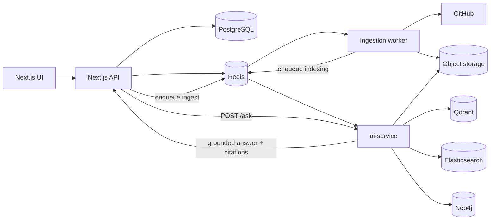
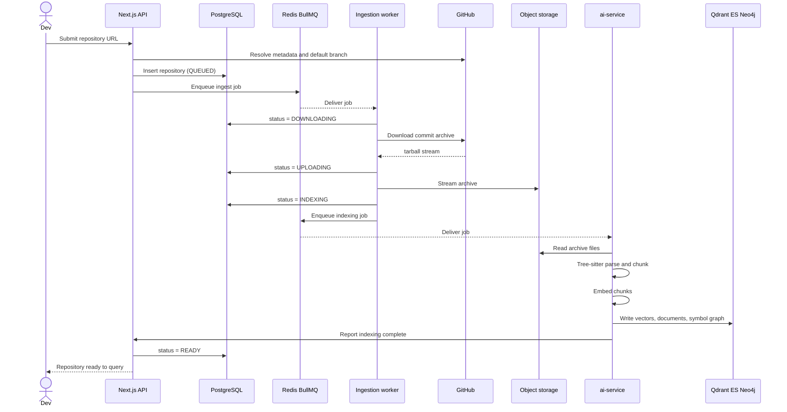
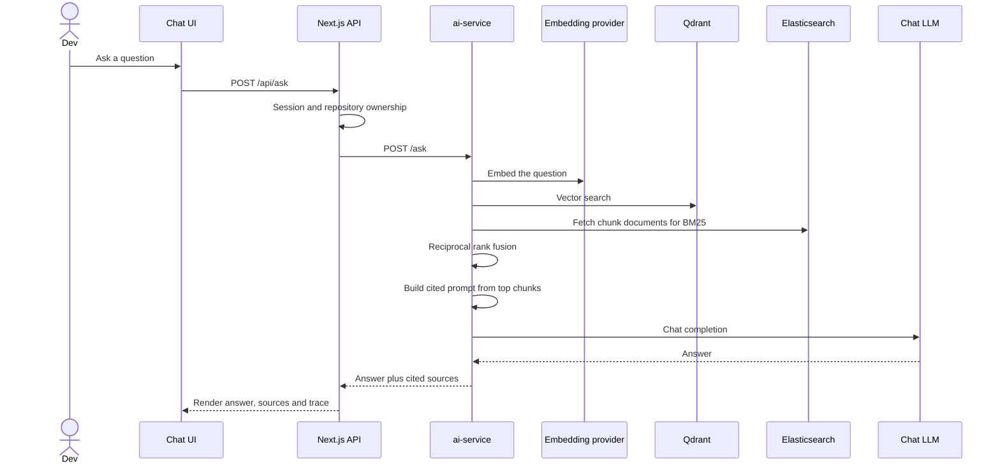
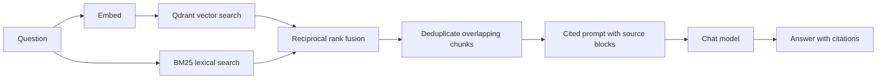

# NexusRAG

> Repository intelligence: ask questions about a codebase and get answers grounded in the actual source.

Large repositories do not fit in a model's context window, and pasting one in
would be slow, expensive and mostly noise. NexusRAG takes the other route: it
parses a repository into code-aware chunks, indexes them for vector, lexical and
graph search, and retrieves only the code that matters before an LLM ever sees
the question. Every answer cites the files and symbols it used.

```text
"Where is authentication implemented?"
"What depends on UserService?"
"Trace what happens when POST /api/login is called."
"Explain how the payment processing pipeline works."
```

---

## How it works

A repository moves through one ingestion pipeline and later through one query
pipeline. The two halves are intentionally split:

- **Ingestion is TypeScript** (Next.js + a BullMQ worker). It deals with GitHub,
  the database and object storage.
- **Code understanding is Python** (FastAPI + a queue consumer). It deals with
  Tree-sitter, embeddings and the three indexes.

They meet at the queue, not over HTTP, so indexing retries, resumes and scales
independently of the web app.



---

## System design

### Ingestion

Submitting a repository is a five-stage pipeline. Each stage records its own
status, and BullMQ retries with backoff before a repository is ever marked
`FAILED`. The Python stage is handed the archive through a separate queue, so
two consumers never race for the same job.



Status lifecycle:

```text
QUEUED → DOWNLOADING → UPLOADING → INDEXING → READY
                                        ↘ FAILED (after retries)
```

### Query

Questions never reach the model without evidence. Retrieval happens first, and
the answer prompt contains only the retrieved code.



### Hybrid retrieval

A cosine similarity and a BM25 score are not on a common scale, so fusing them
by value would let whichever happens to produce larger numbers dominate. NexusRAG
fuses by **rank position** instead (Reciprocal Rank Fusion, `k = 60`), which
needs no normalisation and cannot be skewed by score scales. The same fusion
rule is implemented on both sides (`packages/retrieval` and
`ai_service/retrieval.py`) so the two never drift apart.



If Elasticsearch is unreachable the lexical side contributes nothing and vector
hits still answer the question; if the model has no API key, retrieval results
are returned on their own rather than faked.

### Code graph

Semantic search cannot answer "what depends on AuthService". Parsing also emits
a symbol graph — files, symbols and the relationships between them — which is
written to Neo4j and served to the `/graph` and `/code-graph` pages. Structural
questions are answered by traversal, not by similarity.

---

## Tech stack

| Layer            | Technology                                         |
| ---------------- | -------------------------------------------------- |
| Frontend         | Next.js (App Router), TypeScript, Tailwind CSS     |
| Application API  | Next.js route handlers                             |
| AI service       | FastAPI (Python), uv                               |
| Monorepo         | pnpm workspaces + Turborepo                        |
| Database         | PostgreSQL + Prisma                                |
| Sessions / Queue | Redis + BullMQ                                     |
| Code parsing     | Tree-sitter                                        |
| Vector search    | Qdrant                                             |
| Lexical search   | Elasticsearch                                      |
| Code graph       | Neo4j                                              |
| Object storage   | Cloudflare R2 or any S3-compatible store           |
| Models           | Any OpenAI-compatible host for chat and embeddings |
| CI               | GitHub Actions                                     |

Parsing covers Python, JavaScript/TypeScript, Go, Rust, Java, Kotlin, Scala,
Ruby, PHP, C/C++, Swift, Objective-C, Bash, SQL and HTML.

---

## Repository layout

```text
nexusrag/
├── apps/
│   ├── web/                # Next.js app: dashboard, chat, graph pages, auth
│   ├── worker/             # BullMQ worker: downloads archives into storage
│   └── ai-service/         # FastAPI + queue consumer: parse, chunk, embed, index
├── packages/
│   ├── database/           # Prisma schema and client
│   ├── redis/              # Shared Redis client
│   ├── queue/              # Queue definitions and job shapes
│   ├── github/             # GitHub URL validation, metadata, archive URLs
│   ├── storage/            # S3-compatible archive storage
│   ├── retrieval/          # Hybrid retrieval building blocks (TS side)
│   ├── search/             # Elasticsearch lexical search
│   ├── graph/              # Neo4j code graph
│   ├── ui/                 # Design tokens shared with the web app
│   ├── eslint-config/      # Shared ESLint config
│   └── typescript-config/  # Shared tsconfig files
├── scripts/                # Repository tooling (env:check, etc.)
└── .github/workflows/      # CI
```

---

## Getting started

### 1. Prerequisites

Node.js 22+, pnpm, Python 3.12+ with [uv](https://docs.astral.sh/uv/), and
access to PostgreSQL, Redis, Qdrant, Elasticsearch, Neo4j and an S3-compatible
store. Managed free tiers work fine for everything except Elasticsearch.

### 2. Install

```bash
pnpm install
pnpm ai:install      # Python dependencies for apps/ai-service
```

### 3. Configure

Everything reads from a single `.env` at the repo root.

```bash
cp .env.example .env
```

Each variable in `.env.example` documents where to get the value and what the
provider-specific gotchas are. Short version:

| Variable                                                     | Where it comes from                                                                       |
| ------------------------------------------------------------ | ----------------------------------------------------------------------------------------- |
| `DATABASE_URL`                                               | Aiven / Neon / Supabase connection string. Append `?sslmode=require`.                     |
| `REDIS_URL`                                                  | Upstash / Redis Cloud. **Use `rediss://`** so TLS is selected.                            |
| `QDRANT_URL`, `QDRANT_API_KEY`                               | Qdrant Cloud cluster URL + API key from the console.                                      |
| `ELASTICSEARCH_URL`, `ELASTICSEARCH_API_KEY`                 | Elastic Cloud deployment URL. The key is the base64 string **only**, no `ApiKey ` prefix. |
| `NEO4J_URI`, `NEO4J_USERNAME`, `NEO4J_PASSWORD`              | Neo4j Aura connection details. Keep the `neo4j+s://` scheme exactly as given.             |
| `CLOUDFLARE_ACCOUNT_ID`, `R2_*` **or** `S3_*`                | Either Cloudflare R2, or MinIO / any S3-compatible provider. `S3_*` wins when set.        |
| `GITHUB_CLIENT_ID`, `GITHUB_CLIENT_SECRET`                   | GitHub → Settings → Developer settings → OAuth Apps.                                      |
| `LLM_BASE_URL`, `LLM_MODEL`, `LLM_API_KEY`                   | Chat model. Defaults to OpenAI; any OpenAI-compatible host works.                         |
| `EMBEDDING_BASE_URL`, `EMBEDDING_MODEL`, `EMBEDDING_API_KEY` | Embeddings. Falls back to the LLM host and key.                                           |

### 4. Verify

```bash
pnpm env:check
```

This reports each service twice: whether the variables are present, and whether
the service actually answers. It is read-only and safe to re-run.

```text
  PASS  postgres         configured
  PASS  postgres         reachable (412ms)
  FAIL  qdrant           unreachable -- ConnectError: getaddrinfo ENOTFOUND ...
```

Fix whatever it flags before going further — every later failure is easier to
diagnose from this output.

### 5. Database

```bash
pnpm db:generate
pnpm db:migrate
```

### 6. Run

```bash
pnpm dev          # web + ingestion worker
pnpm dev:ai       # ai-service API on :8000
pnpm ai:worker    # ai-service queue consumer (indexing)
```

---

## AI providers

Chat and embeddings are configured separately, so each can use a different host,
model and key. The wire format is the OpenAI one, which most hosted inference
servers accept unchanged — so pointing at another vendor is a `.env` edit, not a
code change.

```env
# Chat
LLM_BASE_URL=https://your-host/v1
LLM_MODEL=your-model
LLM_API_KEY=your-key

# Embeddings — can be a different host entirely
EMBEDDING_BASE_URL=https://your-embed-host/v1
EMBEDDING_API_KEY=your-embed-key
EMBEDDING_MODEL=your-embed-model
EMBEDDING_DIMENSIONS=768
```

`EMBEDDING_BASE_URL` falls back to `LLM_BASE_URL`; `EMBEDDING_API_KEY` falls
back to `LLM_API_KEY` and then `OPENAI_API_KEY`. So one host and one key is
enough for the common case.

Two things to watch:

- `EMBEDDING_DIMENSIONS` must match the Qdrant collection size.
- Vectors from different embedding models live in different spaces — changing
  `EMBEDDING_MODEL` means re-indexing every repository.

Without a key, embeddings fall back to deterministic vectors. They are stable
but carry no meaning, so retrieval quality in that mode is not real; the
service logs a warning whenever it selects them.

---

## Scripts

| Script                                                      | What it does                                    |
| ----------------------------------------------------------- | ----------------------------------------------- |
| `pnpm dev`                                                  | Web app + ingestion worker                      |
| `pnpm dev:ai`                                               | ai-service HTTP API on :8000                    |
| `pnpm ai:worker`                                            | ai-service queue consumer                       |
| `pnpm build`                                                | Build every workspace                           |
| `pnpm lint` / `pnpm check-types`                            | ESLint / TypeScript across all workspaces       |
| `pnpm test`                                                 | Unit tests                                      |
| `pnpm test:ingestion`                                       | Live ingestion tests (network + Redis required) |
| `pnpm ai:test` / `pnpm ai:lint`                             | pytest / ruff for the Python service            |
| `pnpm env:check`                                            | Validate `.env` and probe every service         |
| `pnpm db:generate` / `db:migrate` / `db:push` / `db:studio` | Prisma tooling                                  |
| `pnpm format`                                               | Prettier across the repo                        |

---

## Testing

- **Unit tests** — `pnpm test` runs the TypeScript suites across workspaces.
- **Python tests** — `pnpm ai:test` runs pytest for parsing, chunking, fusion
  and the HTTP surface.
- **Live ingestion** — `pnpm test:ingestion` walks a real repository through the
  whole pipeline against real Redis; it is kept separate because it needs
  outbound network access.
- **CI** — every push and pull request runs lint, type checks, unit tests and a
  production build; the live-ingestion suite runs as its own job with a Redis
  service container.

---

## Security

Implemented:

- **CSRF** — every state-changing request must be same-origin (Origin, with
  `Sec-Fetch-Site` and `Referer` as fallbacks), on top of `SameSite=Lax`.
- **Idempotency** — `Idempotency-Key` on repository submission; a retried
  request replays the original response instead of enqueueing twice.
- **Rate limiting** — Redis fixed-window, per-IP and per-account on auth, plus
  per-user on ingestion and polling.
- **Session hardening** — 256-bit tokens, SHA-256 hashed at rest in Redis,
  `httpOnly` + `SameSite` + `maxAge`, unguessable cookie name.
- **Security headers** — CSP, `nosniff`, `X-Frame-Options: DENY`, HSTS,
  `Referrer-Policy`, `Permissions-Policy`, no `X-Powered-By`.
- **Path traversal** — archive paths are validated; absolute paths, `..`
  segments and non-GitHub layouts are rejected.
- **SSRF hardening** — GitHub URLs are host-allowlisted, HTTPS-only, and
  re-validated before any outbound request is built from them.
- **Error hygiene** — internal exceptions never reach a response body.
- **Ownership** — the repository list for a question is resolved from the
  database against the session, never from the request body.

---

## Roadmap

Shipped:

- [x] Repository ingestion pipeline with retries and resumable stages
- [x] Tree-sitter parsing, code-aware chunking, symbol extraction
- [x] Embedding pipeline with Qdrant vector search
- [x] Elasticsearch lexical search and rank fusion
- [x] Neo4j code graph with graph and symbol-map views
- [x] Cited RAG answers with a retrieval trace inspector
- [x] Evaluation harness measuring latency and citations

Next:

- [ ] Incremental indexing on new commits
- [ ] Branch-aware indexes
- [ ] Dependency-impact analysis in the UI
- [ ] Pull request review integration
- [ ] Editor integration
- [ ] Self-hosted model presets

---

## Contributing

NexusRAG is under active development. Contributions, ideas and bug reports are
welcome. Run `pnpm lint`, `pnpm check-types` and `pnpm test` before opening a
pull request.

## License

MIT

---

<p align="center"><em>Understand the codebase, not just the code.</em></p>
